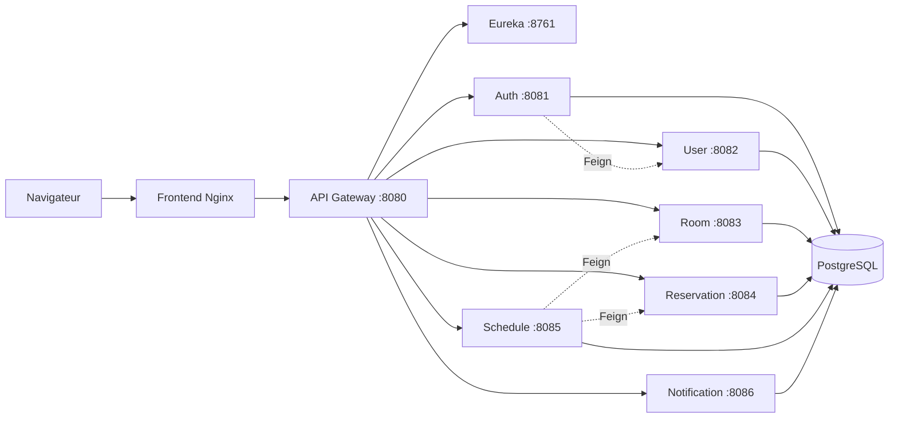

# Timora

Plateforme **Full Stack** de gestion des salles, réservations et emplois du temps universitaires.

Architecture **microservices** (Java 21 / Spring Boot / Spring Cloud) + SPA **Angular 20**, déployée avec **Docker Compose**.

---

## Fonctionnalités

- Authentification **JWT** (access / refresh, BCrypt, reset mot de passe)
- Espaces **Administrateur** et **Enseignant** (guards par rôle)
- CRUD utilisateurs, étudiants, salles, équipements, cours, filières, UE
- **Génération automatique** d’emplois du temps
- **Détection et résolution de conflits** (enseignant, salle, groupe, capacité, horaires…)
- Réservations avec suggestion / assignation de salles et cache de disponibilité
- Import **Excel** (Apache POI) et export **PDF** (jsPDF)
- Notifications **e-mail** (compte, mot de passe, diffusion d’EDT)
- Dashboards KPI (**ApexCharts**)
- APIs REST documentées **OpenAPI / Swagger**

---

## Architecture



| Service | Port | Rôle |
|---|---:|---|
| Frontend (Angular / Nginx) | 80 | Interface Admin & Enseignant |
| API Gateway | 8080 | Routage `/api/**`, CORS |
| Eureka Server | 8761 | Service discovery |
| Config Server | 8888 | Configuration centralisée |
| Auth Service | 8081 | Login, JWT, reset password |
| User Service | 8082 | Utilisateurs & étudiants |
| Room Service | 8083 | Salles & équipements |
| Reservation Service | 8084 | Réservations & disponibilités |
| Schedule Service | 8085 | Emplois du temps & conflits |
| Notification Service | 8086 | E-mails |
| Reporting / Integration | 8087 / 8088 | Services d’extension |

---

## Stack

| Couche | Technologies |
|---|---|
| Backend | Java 21, Spring Boot 3.5, Spring Cloud (Gateway, Eureka, Config), OpenFeign, JPA / Hibernate |
| Frontend | Angular 20 (standalone), TypeScript, RxJS, ApexCharts, jsPDF |
| Données | PostgreSQL 15 |
| Messaging | RabbitMQ 3 |
| Sécurité | JWT, Spring Security, BCrypt, RBAC, HTTPS (Let’s Encrypt) |
| DevOps | Docker, Docker Compose, Nginx, GitLab CI/CD, Maven, npm |
| Tests | Karma / Jasmine, Jest, Selenium WebDriver |

---

## Structure du dépôt

```
Timora/
├── frontend/                  # Application Angular 20
├── timora-gateway/            # API Gateway
├── timora-eureka-server/      # Service discovery
├── timora-config-server/      # Config Server
├── timora-auth-service/       # Authentification JWT
├── timora-user-service/       # Utilisateurs & étudiants
├── timora-room-service/       # Salles & équipements
├── timora-reservation-service/
├── timora-schedule-service/   # EDT & conflits
├── timora-notification-service/
├── timora-reporting-service/
├── timora-integration-service/
├── docker/                    # Dockerfiles & Nginx
├── scripts/                   # Scripts de démarrage / BDD / e-mail
├── docs/                      # Documentation
├── docker-compose.yml
├── env.example
└── pom.xml                    # Parent Maven (11 modules)
```

---

## Démarrage rapide (Docker)

Prérequis : Docker, Docker Compose, 4 Go RAM (8 Go recommandés).

```bash
git clone <url-du-depot>
cd Timora
cp env.example .env
docker compose up -d --build
```

| URL | Description |
|---|---|
| http://localhost | Frontend |
| http://localhost:8080 | API Gateway |
| http://localhost:8761 | Eureka |
| http://localhost:8080/swagger-ui.html | OpenAPI (via services) |
| http://localhost:15672 | RabbitMQ Management |

Arrêt : `docker compose down`

Guide détaillé : [docs/deployment.md](docs/deployment.md)

---

## Développement local

**Backend** (Java 21, Maven, PostgreSQL) :

```bash
# Windows
scripts\start-all-services.bat

# Linux / macOS
./scripts/setup-postgres.sh
./scripts/start-all-services.sh
```

**Frontend** :

```bash
cd frontend
npm install
npm start
```

L’application Angular tourne sur http://localhost:4200 et proxy `/api` vers le Gateway (`:8080`).

---

## Scripts

Voir [scripts/README.md](scripts/README.md).

| Script | Rôle |
|---|---|
| `scripts/start-all-services` | Démarre les 11 microservices |
| `scripts/stop-all-services` | Arrête les services |
| `scripts/setup-postgres.sh` | Prépare PostgreSQL |
| `scripts/create-databases.*` | Crée les bases |
| `scripts/configure-email.ps1` | Configure SMTP |

---

## Tests

```bash
# Unitaires frontend
cd frontend && npm test

# E2E Selenium
cd frontend && npm run test:e2e

# Selenium Grid (optionnel)
docker compose -f docker-compose.selenium.yml up -d
```

---

## Documentation

- [Déploiement VPS](docs/deployment.md)
- [Gestion des conflits](docs/conflicts.md)
- [Architecture frontend](docs/frontend-architecture.md)
- [Algorithme d’emploi du temps](docs/algorithme-emploi-du-temps.ipynb)

---

## Auteurs

Projet réalisé en équipe (IUSJC) — 2025–2026.
